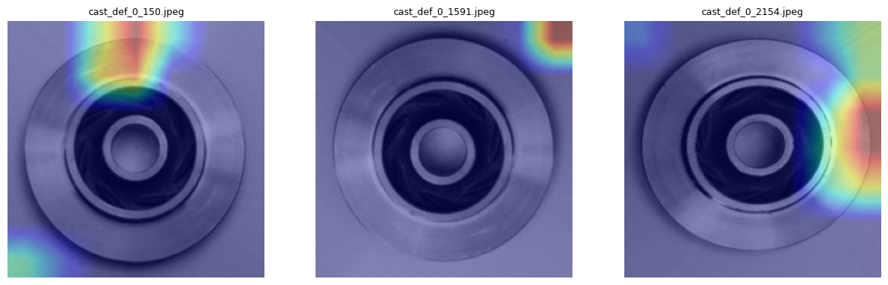

# casting-defect-detection
**Live demo:** https://casting-defect-detector.streamlit.app/
   

ResNet18 classifier for casting defect detection on industrial impeller images (PyTorch)

## Data

Kaggle "Casting Product Image Data for Quality Inspection" (300×300 grayscale images of cast impeller parts, labeled `def_front` for defective and `ok_front` for OK).

| Split | Defective | OK | Total |
|---|---|---|---|
| Train | 3,758 | 2,875 | 6,633 |
| Test | 453 | 262 | 715 |

The training folder is further split into 5,639 training and 994 validation images (15% held out, seed 42). The test set was used only for final evaluation.

## Problem

Casting defects such as porosity, inclusions, shrinkage, and cracks can cause part failures and costly rework. This project trains an image classifier that flags defective impeller castings from photos, so inspectors can focus on the parts most likely to be bad.

## Method

- **Model:** ResNet18 pretrained on ImageNet, with the final layer replaced for two classes
- **Preprocessing:** images converted to 3-channel grayscale, resized to 224×224, normalized with ImageNet statistics
- **Augmentation:** random horizontal flips (training only)
- **Training:** Adam optimizer (learning rate 1e-4), batch size 32, 5 epochs, cross-entropy loss
- **Model selection:** checkpoint with the lowest validation loss (epoch 4)
- **Framework:** PyTorch and torchvision, run on a Google Colab T4 GPU

## Results

Evaluated on the held-out test set (715 images, never used for training or model selection):

- **Accuracy:** 0.996 (712 of 715 correct)
- **Defect recall:** 0.993 (450 of 453 defective parts caught)
- **Defect precision:** 1.000 (no OK parts wrongly flagged)
- **Missed defects:** 3

| Metric | Defective | OK |
|---|---|---|
| Precision | 1.000 | 0.989 |
| Recall | 0.993 | 1.000 |
| F1-score | 0.997 | 0.994 |

Confusion matrix (rows = true, columns = predicted):

|  | Predicted defective | Predicted OK |
|---|---|---|
| **True defective** | 450 | 3 |
| **True OK** | 0 | 262 |

## Grad-CAM analysis

To understand the three missed defects, I generated Grad-CAM heatmaps showing which image regions drove the model's prediction. For all three, the strongest attention fell on the background and image edges rather than on the casting itself. This suggests the model may partly rely on framing or lighting cues instead of the defect.

   
   
This analysis covers only three errors, so it's a starting point, not a conclusion. Checking correctly classified defects would show whether the model normally focuses on the part.

## Limitations and next steps

**Limitations**
- The dataset comes from a single production setup, so performance on other factories, lighting, or camera setups is unknown.
- Only three errors were available for Grad-CAM analysis, so the background-cue finding is preliminary.
- Results come from one training run with one random seed.

**Next steps**
- Generate Grad-CAM heatmaps for correctly classified defects to see whether the model normally focuses on the part.
- Test stronger lighting and framing augmentation, and check whether the three misses change.
- Repeat training with several seeds to report mean and variance.
- Evaluate on images from a different production setup, if available.

## How to run

1. Click the **Open In Colab** badge at the top of this README.
2. Select **Runtime → Change runtime type → T4 GPU**.
3. Run the cells in order. In the data download cell, upload your Kaggle API token (`kaggle.json`). You can create one at kaggle.com under **Settings → API**.
4. The notebook downloads the dataset, trains ResNet18, and prints the test results.

Training takes about 5 minutes on a T4 GPU.

## Acknowledgments

- Dataset: "Casting Product Image Data for Quality Inspection" on Kaggle, uploaded by ravirajsinh45 (kaggle.com/datasets/ravirajsinh45/real-life-industrial-dataset-of-casting-product)
- Pretrained weights: ResNet18 from torchvision (ImageNet)
- Badge: Google Colab

